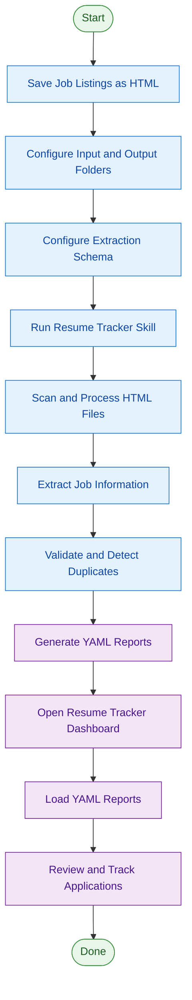
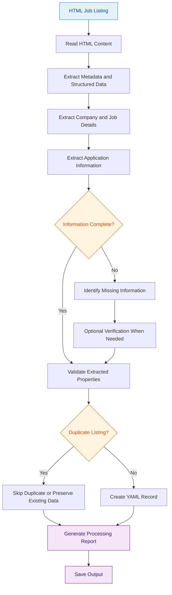

# Resume Tracker Skill

A configurable AI skill that turns saved job listings into structured YAML records, helping you organize, track, and review your job applications in one place.

Instead of manually entering company names, job titles, application dates, and contact information, simply save job listing pages as HTML files and let the skill extract the relevant information.

The repository also includes an interactive HTML dashboard for managing and reviewing your application history.

---

## Overview

**The workflow is simple:**

1. Save job listings as HTML files.
2. Configure the input, configuration, and output folders.
3. Run the Resume Tracker Skill.
4. Review the generated YAML reports.
5. Load your reports into the HTML dashboard.

## Workflow

### 1. End-to-End Workflow



### 2. Information Extraction Workflow



---

## How This Works

- When applying for a job, save each job listing page as an HTML file using a browser extension or `Ctrl + S`.
- Configure the folder containing these HTML files as your skill's `INPUT_FOLDER`.
- A configuration folder is provided in this repository. You can add or remove properties depending on your needs.
- Changes to the configuration determine which information gets extracted.
- Specify an absolute path for your `OUTPUT_FOLDER`.
- The skill generates reports in YAML format.
- These reports can be viewed individually or combined in the `Resume-Tracker-Dashboard.html` file included in this repository.

---

## Configuration

Before running the skill, configure the following paths:

```yaml
INPUT_FOLDER: "JobTracker/JobListings"
CONFIG_FILE: "JobTracker/Config/extraction.yaml"
OUTPUT_FOLDER: "JobTracker/Output"
```

| Property | Description |
|---|---|
| `INPUT_FOLDER` | Folder containing saved HTML job listings. |
| `CONFIG_FILE` | Configuration file defining the YAML output structure. |
| `OUTPUT_FOLDER` | Destination folder for generated YAML reports. |

**Important:** Configure these paths according to your local environment. Use absolute paths where required.

### Configure the Output Schema

The skill uses the configuration file to determine which properties should be extracted.

Example configuration:

```yaml
Jobs:
  - CompanyName: ""
    Address: ""
    Email: null
    OnlineFormApplying: true
    ApplyingDate: "dd-mm-yyyy"
    Status: ""
    Notes: ""
    JobTitle: ""
    Link: ""
```

You can customize the properties according to your requirements.

The skill preserves:

- Top-level property names.
- Field names and capitalization.
- Configured data types.
- The complete structure of every job record.

Every generated record must follow the configured schema.

---

## Extraction Features

### Job Information

The skill extracts relevant information from saved HTML pages, including:

- Company name
- Company address
- Job title
- Application email
- Application method
- Application date
- Job listing URL
- Application status
- Additional notes

### Application Method Detection

The skill identifies whether a job listing provides a specific email address for applications.

- If a specific application email is available, it is extracted and `OnlineFormApplying` is set to `false`.
- Otherwise, `OnlineFormApplying` defaults to `true`.

This default also applies to platforms such as Indeed, Xing, and StepStone.

### Application Date

The application date is determined using the saved HTML file's filesystem creation date.

The date is converted to local time and formatted as:

```text
dd-mm-yyyy
```

The publication date, current date, and modification date are not used as substitutes.

### Duplicate Detection

The skill checks for duplicate job listings using:

1. Original job listing URL.
2. Company name and job title when the original URL is unavailable.

Existing valid records are preserved when updating the output.

### Missing Information

The skill does not invent or guess missing information.

- Unavailable string values are represented by empty strings.
- Unavailable nullable values are represented by `null`.
- Boolean properties retain their configured data types.
- Uncertain or incomplete information is identified in the processing report.

Optional verification can be used when information cannot be established from the saved HTML page.

---

## Output

The skill generates a YAML report in the configured output folder:

```text
OUTPUT_FOLDER/
    jobs.yaml
```

Each unique job listing is represented by one YAML record.

The generated YAML:

- Follows the configured schema.
- Contains valid YAML syntax.
- Preserves existing valid records.
- Avoids duplicate entries.
- Identifies incomplete or uncertain information.

### Example Output

```yaml
Jobs:
  - CompanyName: "Example GmbH"
    Address: "Stuttgart, Germany"
    Email: null
    OnlineFormApplying: true
    ApplyingDate: "13-11-2026"
    Status: "Applied"
    Notes: ""
    JobTitle: "C# Software Developer"
    Link: "https://example.com/jobs/123"
```

---

## Resume Tracker Dashboard

The repository includes an interactive dashboard:

**`Resume-Tracker-Dashboard.html`**

The dashboard allows you to load one or multiple YAML reports and review your job applications in a single interface.

### Dashboard Features

- **Overview:** Get an overview of your job applications.
- **Status Breakdown:** See applications grouped by their current status.
- **Application Method:** Compare online applications and email applications.
- **File Overview:** Review the entries loaded from each YAML file.
- **Daily Activity:** Visualize applications by date.
- **Company Overview:** Review applications grouped by company.
- **Location Overview:** Review applications grouped by city.
- **Search:** Quickly find specific job applications.
- **Filtering:** Filter applications by status.
- **Sorting:** Organize records according to available fields.
- **Multiple Views:** Switch between card and table layouts.

### How to Use the Dashboard

1. Open `Resume-Tracker-Dashboard.html` in your browser.
2. Load the generated YAML files from your output folder.
3. The dashboard combines the loaded records into one overview.
4. Use search, filters, sorting, and different views to review your applications.

<sub>The dashboard is a standalone HTML file and does not require a backend server.</sub>

---

## Processing Report

After processing, the skill provides a summary of its execution, including:

- Number of HTML files discovered.
- Number of files successfully processed.
- Number of job records extracted.
- Number of duplicate listings detected.
- Number of incomplete records.
- Files that could not be processed.
- Missing or uncertain properties.
- Any optional verification or additional research performed.

This makes it easier to identify problems and review the extraction results.

---

## Important Notes

- Original HTML files are never modified or deleted.
- The skill does not submit job applications.
- The skill does not interact with application submission forms.
- The skill does not modify external websites.
- The output structure is controlled by your configuration file.
- Missing information is never fabricated.
- Multiple YAML reports can be loaded into the dashboard together.

---

## Repository Structure

```text
Resume-Tracker-Skill/
│
├── Config/
│   └── extraction.yaml
│
├── Resume-Tracker-Dashboard.html
├── SKILL.md
├── README.md
└── LICENSE
```

Your input and output folders can be located anywhere on your local machine. Their paths are configured separately in the skill.

---

## License

This project is licensed under the MIT License.
